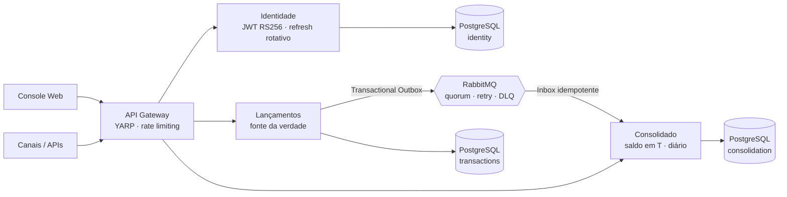

# CashFlow — Lançamentos e Posição Consolidada

Solução para um banco digital registrar movimentações financeiras (créditos e débitos) e fornecer a **posição consolidada de saldo de cada cliente em qualquer instante**, operando de forma confiável sob alta demanda e falhas parciais.

[](../../actions/workflows/ci.yml)

## Visão geral



| Requisito | Como foi atendido |
|---|---|
| Registrar créditos/débitos com consistência | Agregado `Account` com concorrência otimista e retentativas; lançamentos imutáveis; `Idempotency-Key` obrigatório |
| Saldo consolidado em um instante | `GET /accounts/{id}/balance?at=` = consolidados diários anteriores + lançamentos do dia até T |
| Operar com instabilidade/falhas parciais | Lançamentos não depende do Consolidado; **Transactional Outbox** + **Inbox**; retry com atraso e **DLQ**; health checks degradam sem derrubar |
| Alta demanda | Serviços stateless; outbox com `FOR UPDATE SKIP LOCKED`; KEDA por profundidade de fila; **50 req/s no consolidado com 0% de erro (p95 8,8 ms)** |
| Proteção de dados sensíveis | CPF/CNPJ com AES-256-GCM + blind index; eventos sem PII; segredos fora do código; WAF + rate limiting |
| Documentação | TOGAF + C4 (L1/L2/L3 + Structurizr) + 15 ADRs em [`docs/`](docs/README.md) |

## Como executar localmente

Há duas formas de rodar o projeto:

| Modo | Quando usar | O que roda no Docker | O que roda na máquina |
|---|---|---|---|
| **A. Tudo no Docker** | Ver a solução funcionando, demo, teste de carga | Toda a stack | Nada |
| **B. Debug no Visual Studio** | Colocar breakpoints e depurar as APIs | Só PostgreSQL e RabbitMQ | Identity, Transactions, Consolidation e Gateway |

Os passos 0 e 1 valem para os dois modos. A partir do passo 1, **todos os comandos rodam na raiz do repositório** (a pasta que tem o `docker-compose.yml`).

### 0. Pré-requisitos

| Ferramenta | Modo A (Docker) | Modo B (debug) |
|---|:---:|:---:|
| Docker Desktop (com WSL 2) | ✅ | ✅ |
| Git | ✅ | ✅ |
| .NET SDK 10.0 | só para testes | ✅ |
| Visual Studio 2026 (workload *ASP.NET e desenvolvimento web*) ou VS Code + C# Dev Kit | — | ✅ |
| PowerShell (Windows) **ou** bash + openssl (Linux/macOS/WSL) | ✅ | ✅ |

Para conferir o que já está instalado:

```powershell
git --version
docker --version
docker compose version
dotnet --list-sdks      # deve listar uma versão 10.0.x
```

#### Opção 1 — Instalar pelo PowerShell (winget)

O `winget` já vem no Windows 10/11. Abra o **PowerShell como Administrador** e rode só as linhas do que estiver faltando:

```powershell
# WSL 2 (necessário para o Docker Desktop). Reinicie o computador depois.
wsl --install

# Git
winget install -e --id Git.Git

# Docker Desktop
winget install -e --id Docker.DockerDesktop

# .NET SDK 10
winget install -e --id Microsoft.DotNet.SDK.10

# Visual Studio 2026 Community já com o workload de ASP.NET/web
winget install -e --id Microsoft.VisualStudio.Community --override "--passive --wait --add Microsoft.VisualStudio.Workload.NetWeb --includeRecommended"

# (alternativa ao Visual Studio) VS Code + extensão C# Dev Kit
winget install -e --id Microsoft.VisualStudioCode
code --install-extension ms-dotnettools.csdevkit
```

Depois de instalar: **feche e reabra o terminal** (para atualizar o PATH), abra o **Docker Desktop** uma vez e espere aparecer *Engine running*.

#### Opção 2 — Baixar pelo site

| Ferramenta | Download | Observação |
|---|---|---|
| WSL 2 | https://learn.microsoft.com/windows/wsl/install | Ou rode `wsl --install` como Administrador |
| Git | https://git-scm.com/download/win | Instalação padrão (Next, Next…) |
| Docker Desktop | https://www.docker.com/products/docker-desktop/ | Marque *Use WSL 2 instead of Hyper-V* |
| .NET SDK 10 | https://dotnet.microsoft.com/download/dotnet/10.0 | Baixe o **SDK** (não só o Runtime), Windows x64 |
| Visual Studio 2026 | https://visualstudio.microsoft.com/downloads/ | No instalador, marque o workload **ASP.NET e desenvolvimento web** |
| VS Code (alternativa) | https://code.visualstudio.com/ | Instale a extensão **C# Dev Kit** |

#### Obter o código

```powershell
git clone <url-do-repositorio> CashFlow
cd CashFlow
```

### 1. Gerar os segredos locais
Nenhuma credencial é versionada. O script gera senhas aleatórias, chaves AES-256, a chave RSA de assinatura dos tokens e as connection strings em `secrets/` (ignorado pelo git):

```powershell
# Windows (PowerShell nativo 5.1 ou PowerShell 7)
powershell -ExecutionPolicy Bypass -File .\scripts\generate-secrets.ps1
```
```bash
# Linux / macOS / WSL
./scripts/generate-secrets.sh
```

Rode uma vez só. Rodar de novo com `-Force` gera senhas novas e invalida os dados que já estão nos volumes do Docker; nesse caso, apague os volumes com `docker compose down -v`.

### 2A. Rodar tudo no Docker

Com o Docker Desktop aberto, na raiz do repositório:

```powershell
docker compose up -d --build --wait
```

A primeira subida demora alguns minutos (build das imagens). Para acompanhar ou parar:

```powershell
docker compose ps                 # status dos containers
docker compose logs -f gateway    # logs de um serviço
docker compose down               # para tudo (mantém os dados)
docker compose down -v            # para tudo e apaga os dados
```

| Serviço | URL |
|---|---|
| Console Web | http://localhost:8080 |
| API (Gateway) | http://localhost:8000 |
| RabbitMQ Management | http://localhost:15672 (usuário `cashflow`, senha em `secrets/infra/rabbitmq.conf`) |
| Jaeger (opcional) | `docker compose --profile observability up -d` → http://localhost:16686 |

Usuários criados na primeira subida, nos dois modos (senhas geradas no passo 1):

| Usuário | Perfil | Escopos | Senha |
|---|---|---|---|
| `operador` | operator | `transactions:write` `transactions:read` `balances:read` | `secrets/identity/Identity__SeedUsers__0__Password` |
| `analista` | analyst | `transactions:read` `balances:read` | `secrets/identity/Identity__SeedUsers__1__Password` |

### 2B. Debugar no Visual Studio

As APIs rodam no Visual Studio (com breakpoints) e só a infraestrutura fica no Docker.

**1. Gerar os segredos de desenvolvimento** (uma vez, e de novo sempre que regenerar `secrets/`). O script copia `secrets/` para `secrets/dev/` trocando os hosts `postgres`/`rabbitmq` por `localhost`:

```powershell
powershell -ExecutionPolicy Bypass -File .\scripts\derive-dev-secrets.ps1
```

**2. Subir só o PostgreSQL e o RabbitMQ:**

```powershell
docker compose up -d --wait postgres rabbitmq
```

> Os containers `identity`, `transactions`, `consolidation` e `gateway` precisam ficar **parados**. Se rodarem junto com o Visual Studio, eles disputam a mesma fila e o outbox. Se a stack completa estiver no ar: `docker compose stop identity transactions consolidation gateway web`.

**3. Abrir e rodar no Visual Studio:**

1. Abra `CashFlow.slnx`.
2. Na barra de ferramentas, ao lado do botão ▶, escolha o perfil **"Todos os serviços (debug local)"** (definido em `CashFlow.slnLaunch`). Se ele não aparecer, feche e reabra a solução.
3. Coloque os breakpoints e aperte **F5**. As 4 APIs sobem juntas, cada uma na sua janela de console.

Para depurar uma API só, escolha o projeto dela como projeto de inicialização. As outras podem rodar fora do debug:

```powershell
dotnet run --project src/API/CashFlow.Identity.Api
```

| Serviço | URL |
|---|---|
| API (Gateway) | http://localhost:5000 |
| Transactions | http://localhost:5001 — documentação em `/scalar` |
| Consolidation | http://localhost:5002 — documentação em `/scalar` |
| Identity | http://localhost:5003 |
| RabbitMQ Management | http://localhost:15672 |

No ambiente `Development` as migrations são aplicadas sozinhas na subida.

**Com VS Code:** abra a pasta, vá em *Run and Debug*, escolha *C#: Launch Startup Project* e rode cada API pelo perfil do seu `launchSettings.json`.

**Front-end (web) junto com o debug:** o container `web` do Compose encaminha `/api`, `/auth` e `/.well-known` para o container `gateway`, que fica parado neste modo. Use o mesmo nginx com o [`nginx.dev.conf`](src/Web/cashflow-web/nginx.dev.conf), que aponta para o Gateway do Visual Studio (`host.docker.internal:5000`). Com as APIs rodando, execute na raiz do repositório:

```powershell
docker run --rm --name cashflow-web-dev -p 8080:8080 `
  -v "${PWD}/src/Web/cashflow-web/public:/usr/share/nginx/html:ro" `
  -v "${PWD}/src/Web/cashflow-web/nginx.dev.conf:/etc/nginx/conf.d/default.conf:ro" `
  nginxinc/nginx-unprivileged:1.29-alpine
```

Abra http://localhost:8080. A pasta `public/` é montada direto no container: alterou `app.js`, `index.html` ou `styles.css`, basta recarregar a página, sem rebuild. Para parar, `Ctrl+C` (ou `docker stop cashflow-web-dev`). Se a porta 8080 estiver ocupada, pare o container `web` do Compose: `docker compose stop web`.

**Problemas comuns**

| Sintoma | Causa / solução |
|---|---|
| `no configuration file provided: not found` | O comando foi rodado fora da raiz do repositório (o PowerShell como Administrador abre em `C:\WINDOWS\system32`). Faça `cd` até a pasta do projeto, onde fica o `docker-compose.yml` |
| `ConnectionStrings:... não configurada` | Falta o passo 1 (`derive-dev-secrets.ps1`) |
| Erro de conexão em `localhost:5432` ou `5672` | Infra não subiu: `docker compose up -d --wait postgres rabbitmq` |
| `address already in use` nas portas 5000–5003 | Já existe uma instância rodando; pare-a (ou feche o console antigo) |
| Senha do Postgres recusada | `secrets/` foi regenerado depois de criar o volume: `docker compose down -v` e suba de novo |

### 3. Usar a API

Use a URL do Gateway conforme o modo: **`http://localhost:8000`** no Docker e **`http://localhost:5000`** no debug.

**PowerShell (Windows):**

```powershell
$BASE = 'http://localhost:8000'   # ou http://localhost:5000 no modo debug
$PASS = Get-Content secrets\identity\Identity__SeedUsers__0__Password -Raw
$TOKEN = (Invoke-RestMethod -Method Post "$BASE/auth/token" -ContentType 'application/json' `
  -Body (@{ username = 'operador'; password = $PASS } | ConvertTo-Json)).accessToken
$H = @{ Authorization = "Bearer $TOKEN" }

# Abrir conta
$ACCOUNT = (Invoke-RestMethod -Method Post "$BASE/api/v1/accounts" -Headers $H -ContentType 'application/json' `
  -Body '{"holderName":"Maria Silva","holderDocument":"123.456.789-09","overdraftLimit":100}').id

# Crédito e débito (repetir com a mesma Idempotency-Key não duplica)
Invoke-RestMethod -Method Post "$BASE/api/v1/accounts/$ACCOUNT/transactions" -ContentType 'application/json' `
  -Headers ($H + @{ 'Idempotency-Key' = 'deposito-0001' }) -Body '{"type":"credit","amount":250.50,"description":"Depósito"}'
Invoke-RestMethod -Method Post "$BASE/api/v1/accounts/$ACCOUNT/transactions" -ContentType 'application/json' `
  -Headers ($H + @{ 'Idempotency-Key' = 'saque-0001' }) -Body '{"type":"debit","amount":50}'

# Saldo transacional e posição consolidada
Invoke-RestMethod "$BASE/api/v1/accounts/$ACCOUNT" -Headers $H
Invoke-RestMethod "$BASE/api/v1/accounts/$ACCOUNT/balance" -Headers $H
```

**bash (Linux/macOS/WSL, requer `jq`):**

```bash
BASE=http://localhost:8000
PASS=$(cat secrets/identity/Identity__SeedUsers__0__Password)
TOKEN=$(curl -s -X POST $BASE/auth/token -H 'Content-Type: application/json' \
  -d "{\"username\":\"operador\",\"password\":\"$PASS\"}" | jq -r .accessToken)

# Abrir conta
ACCOUNT=$(curl -s -X POST $BASE/api/v1/accounts -H "Authorization: Bearer $TOKEN" -H 'Content-Type: application/json' \
  -d '{"holderName":"Maria Silva","holderDocument":"123.456.789-09","overdraftLimit":100}' | jq -r .id)

# Crédito (repetir com a mesma Idempotency-Key não duplica)
curl -s -X POST $BASE/api/v1/accounts/$ACCOUNT/transactions -H "Authorization: Bearer $TOKEN" \
  -H 'Content-Type: application/json' -H 'Idempotency-Key: deposito-0001' \
  -d '{"type":"credit","amount":250.50,"description":"Depósito"}'

# Débito
curl -s -X POST $BASE/api/v1/accounts/$ACCOUNT/transactions -H "Authorization: Bearer $TOKEN" \
  -H 'Content-Type: application/json' -H 'Idempotency-Key: saque-0001' \
  -d '{"type":"debit","amount":50}'

# Saldo transacional (fonte da verdade) e posição consolidada (agora ou em um instante)
curl -s $BASE/api/v1/accounts/$ACCOUNT -H "Authorization: Bearer $TOKEN"
curl -s "$BASE/api/v1/accounts/$ACCOUNT/balance" -H "Authorization: Bearer $TOKEN"
curl -s "$BASE/api/v1/accounts/$ACCOUNT/balance?at=2026-10-29T15:00:00Z" -H "Authorization: Bearer $TOKEN"
curl -s "$BASE/api/v1/accounts/$ACCOUNT/daily-balances?from=2026-10-01&to=2026-10-31" -H "Authorization: Bearer $TOKEN"
```

Contratos completos: OpenAPI em [`docs/contratos`](docs/contratos) e AsyncAPI dos eventos em [`docs/contratos/asyncapi.yaml`](docs/contratos/asyncapi.yaml).

### Sem Docker nenhum
Com PostgreSQL e RabbitMQ instalados na máquina, crie os bancos e usuários conforme `deploy/postgres/init-databases.sh` (as senhas estão em `secrets/infra/`), gere `secrets/dev` com `derive-dev-secrets.ps1` e siga o modo 2B a partir do passo 3.

## Testes

```bash
dotnet build CashFlow.slnx -c Release      # 0 erros, 0 warnings (TreatWarningsAsErrors)
dotnet test --solution CashFlow.slnx       # 117 testes; integração usa Testcontainers (requer Docker)
```

Sem Docker, aponte para instâncias existentes com `CASHFLOW_TEST_POSTGRES` e `CASHFLOW_TEST_RABBITMQ` ([detalhes](docs/testes/estrategia-de-testes.md)).

Teste de carga (requisito: consolidado a **50 req/s com no máximo 5% de perda**), com a stack no ar:

```bash
dotnet run -c Release --project src/Tests/CashFlow.LoadTest -- \
  --base-url http://localhost:8000 \
  --password-file secrets/identity/Identity__SeedUsers__0__Password \
  --scenario mixed --rps 50 --write-rps 20 --duration 60
```

| Cenário | Erros | p95 | Observação |
|---|---|---|---|
| 50 rps leitura + 20 rps escrita | 0% | 8,8 ms / 12,8 ms | consolidado convergiu em 0,9 s |
| 90 rps leitura | 0% | 7,7 ms | capacidade |
| 20 rps escrita com RabbitMQ parado 18 s | 0% | 10,0 ms | nenhum lançamento perdido; convergência após o retorno |

## Estrutura

```
├── src/
│   ├── API/                       # 1 - Presentation: CashFlow.Transactions.Api · CashFlow.Consolidation.Api
│   │                              #   · CashFlow.Identity.Api · CashFlow.Gateway (YARP + rate limiting)
│   ├── Application/               # 2 - Application (CQRS): CashFlow.Transactions/Consolidation.Application
│   ├── Domain/                    # 3 - Domain: CashFlow.Transactions/Consolidation.Domain
│   ├── Infrastructure/            # 4 - Infra: CashFlow.Transactions/Consolidation.Infrastructure
│   ├── Tests/                     # 5 - Tests: unitários, contrato, integração, gateway e CashFlow.LoadTest
│   └── Web/cashflow-web/          # Console Web (camada de UI) + Nginx
├── docker/                        # Dockerfiles dos serviços (identity, transactions, consolidation, gateway)
├── docs/                          # TOGAF · C4 · ADRs · contratos · FinOps · runbooks
├── infra/terraform/               # IaC Azure (módulos + ambientes dev/prod)
├── infra/finops/                  # modelo de custos (CSV) + gerador do relatório
├── deploy/postgres/               # init database-per-service
├── scripts/                       # geração de segredos, verificação de licenças
├── docker-compose.yml
└── .github/                       # CI (build, testes, licenças, containers + carga, terraform) e Dependabot
```

Os serviços de negócio seguem Clean Architecture com **CQRS, Repository e Unit of Work**, e a solução agrupa os projetos em `1 - Presentation`, `2 - Application`, `3 - Domain`, `4 - Infra` e `5 - Tests`:

```
CashFlow.Transactions.Api            Controllers/ · Configuration/ApiConfig · Middleware/
CashFlow.Transactions.Application    Abstractions/Messaging/ (ICommand, IQuery, handlers) · Behaviors/ValidationBehavior
                                     Accounts/Commands/OpenAccount/ · Accounts/Queries/GetAccountById/
                                     Transactions/Commands/RegisterTransaction/ · Transactions/Queries/ListTransactions/
                                     Contracts/ · Interfaces/ · Configuration/DependencyInjectionConfig
CashFlow.Transactions.Domain         Entities/Abstracts/ · Models/ · Enums/ · Errors/ · Exceptions/ · Helpers/
                                     Interfaces/Repository/ · Interfaces/Common/IUnitOfWork
CashFlow.Transactions.Infrastructure Context/ · EntityConfiguration/ · Repository/ · UnitOfWork/ · Migrations/
                                     Outbox/ · Messaging/ · Security/ · Health/ · Configurations/DependencyInjectionConfig
```

## Principais decisões

| Decisão | ADR |
|---|---|
| Clean Architecture com CQRS, Repository e Unit of Work | [0013](docs/adr/0013-clean-architecture.md) |
| Dois microsserviços de negócio com database-per-service, comunicação assíncrona | [0002](docs/adr/0002-microsservicos-lancamentos-e-consolidado.md) |
| RabbitMQ (quorum, publisher confirms, retry com TTL, DLQ) | [0003](docs/adr/0003-mensageria-rabbitmq.md) |
| **Sem projeto compartilhado** entre serviços; contratos versionados + testes de contrato | [0004](docs/adr/0004-contratos-sem-projeto-compartilhado.md) |
| JWT RS256 (10 min) + refresh token opaco com rotação e detecção de reuso | [0005](docs/adr/0005-autenticacao-jwt-rs256-e-refresh-token.md) |
| Consistência eventual explícita com projeção comutativa | [0006](docs/adr/0006-consistencia-eventual-e-projecao-comutativa.md) |
| Somente licenças permissivas, versões fixadas, auditoria de vulnerabilidades transitivas | [0007](docs/adr/0007-bibliotecas-e-licencas.md) |
| **.NET 10 LTS** (o .NET 8 sai de suporte em 10/11/2026) | [0010](docs/adr/0010-runtime-dotnet-10-lts.md) |
| Transactional Outbox + Inbox + Idempotency-Key | [0012](docs/adr/0012-transactional-outbox-e-inbox.md) |
| Front Door/WAF + Gateway YARP como proteção ativa | [0014](docs/adr/0014-api-gateway-e-protecao-de-borda.md) |

Lista completa em [`docs/adr`](docs/adr/README.md).

## Nuvem e custos
- **IaC:** [`infra/terraform`](infra/terraform/README.md) — VNet privada, Container Apps (KEDA), PostgreSQL Flexible HA, Key Vault com identidades gerenciadas, Front Door Premium + WAF, Log Analytics, orçamento com alertas.
- **FinOps:** [estimativa estruturada](docs/finops/estimativa-custos.md) gerada de um modelo versionado — produção ~US$ 2.063/mês, dev ~US$ 631/mês, com custo unitário por lançamento, cenários de crescimento e otimizações mapeadas (-18% prod / -53% dev).

## O que ficaria para a próxima iteração
IdP corporativo com MFA, cluster RabbitMQ de 3 nós, estornos com aprovação, transferências via saga, cache distribuído e CDC no lugar do polling do outbox — detalhado em [docs/arquitetura/08-oportunidades-e-migracao.md](docs/arquitetura/08-oportunidades-e-migracao.md).
