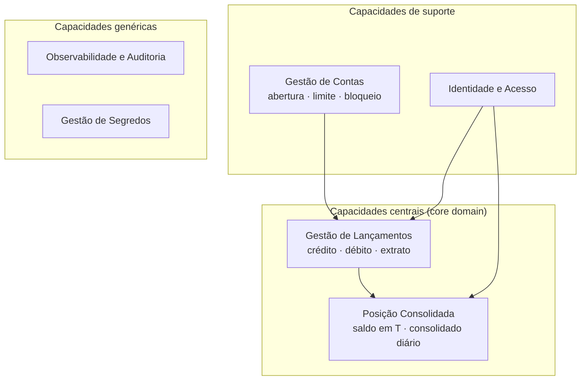
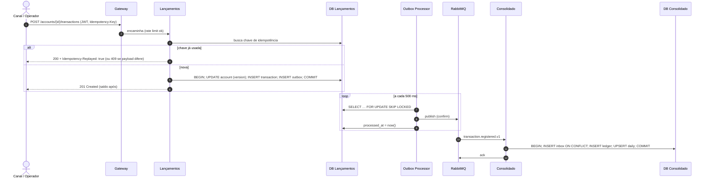

# 2. Arquitetura de Negócio (TOGAF ADM — Fase B)

## 2.1 Mapa de capacidades

## 2.2 Contextos delimitados (DDD) e mapa de contexto

| Contexto | Tipo | Modelo | Serviço |
|---|---|---|---|
| **Lançamentos** | Core | Agregado `Account` (saldo, limite, versão) + `Transaction` imutável | CashFlow.Transactions |
| **Consolidação** | Core (leitura) | `LedgerEntry`, `DailyBalance`, `ConsolidatedAccount` | CashFlow.Consolidation |
| **Identidade** | Suporte | `User`, `RefreshToken`, papéis/escopos | CashFlow.Identity |

Relação: **Lançamentos (upstream) → Consolidação (downstream)** no padrão *Published Language* (eventos versionados documentados em AsyncAPI). A Consolidação não conhece dados pessoais — apenas `AccountId`.

## 2.3 Linguagem ubíqua

| Termo | Definição |
|---|---|
| **Lançamento** | Movimentação financeira imutável (crédito ou débito) em uma conta. Correções são novos lançamentos (estorno), nunca alteração. |
| **Crédito / Débito** | Entrada / saída de valor. Valores sempre positivos; o tipo define o sinal. |
| **Saldo transacional** | Saldo corrente mantido pelo agregado `Account`; fonte da verdade. |
| **Limite (cheque especial)** | Valor que o saldo pode ficar negativo. Débito que ultrapasse `-limite` é rejeitado. |
| **Posição consolidada** | Saldo calculado pela Consolidação para um instante T a partir dos lançamentos projetados. |
| **Consolidado diário** | Totais de créditos e débitos de uma conta em uma data contábil (UTC) e o saldo de fechamento acumulado. |
| **Chave de idempotência** | Identificador fornecido pelo cliente por intenção de lançamento; repetir a chave não repete o efeito. |
| **Defasagem** | Diferença temporal entre o último lançamento efetivado e o último consolidado (`lastEntryAt`). |

## 2.4 Regras de negócio

| ID | Regra | Onde é garantida |
|---|---|---|
| RN01 | Valor > 0, máximo 2 casas decimais, até R$ 10.000.000,00 por lançamento | `RegisterTransactionValidator` |
| RN02 | Débito não pode levar o saldo abaixo de `-limite` | `Account.Register` (sob concorrência otimista) |
| RN03 | Conta bloqueada não movimenta | `Account.Register` |
| RN04 | Mesma chave + mesmo conteúdo → mesmo resultado; mesma chave + conteúdo diferente → conflito | `RegisterTransactionCommandHandler` + unique index |
| RN05 | Um documento (CPF/CNPJ) possui uma única conta | Blind index HMAC único |
| RN06 | Lançamentos são imutáveis | Ausência de endpoints de alteração; tabela append-only |

## 2.5 Processos principais

### Registrar lançamento

### Consultar posição consolidada
`GET /api/v1/accounts/{id}/balance?at=2026-10-29T15:00:00Z` → soma dos consolidados diários anteriores + lançamentos do dia até T. Resposta inclui `lastEntryAt` para o cliente avaliar a defasagem.
