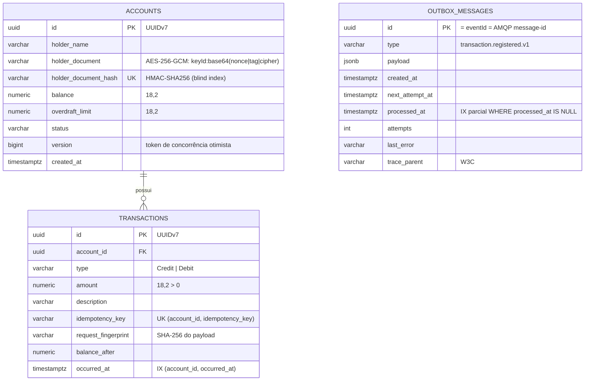
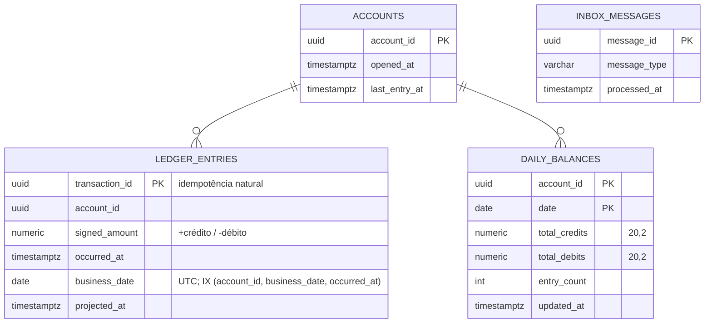

# 3. Arquitetura de Dados (TOGAF ADM — Fase C, Dados)

## 3.1 Propriedade dos dados
Cada serviço é dono exclusivo do seu banco (**database-per-service**) e do seu usuário de banco. Nenhum serviço lê o banco de outro.

| Banco | Dono | Entidades | Classificação |
|---|---|---|---|
| `cashflow_transactions` | Lançamentos | accounts, transactions, outbox_messages | **Confidencial** (contém PII) |
| `cashflow_consolidation` | Consolidado | inbox_messages, ledger_entries, daily_balances, accounts | Interno (sem PII) |
| `cashflow_identity` | Identidade | users, refresh_tokens | **Restrito** (credenciais em hash) |

## 3.2 Modelo — Lançamentos (schema `transactions`)

## 3.3 Modelo — Consolidado (schema `consolidation`)

## 3.4 Contratos de dados entre serviços
- Eventos `transaction.registered.v1` e `account.opened.v1` — [AsyncAPI](../contratos/asyncapi.yaml), [exemplos](../contratos/exemplos).
- APIs REST — OpenAPI gerado: [Lançamentos](../contratos/openapi-transactions.json), [Consolidado](../contratos/openapi-consolidation.json), [Identidade](../contratos/openapi-identity.json).
- **Minimização (LGPD art. 6º, III):** eventos não carregam nome nem documento; o Consolidado não armazena PII.

## 3.5 Consistência, concorrência e integridade

| Cenário | Mecanismo |
|---|---|
| Dois débitos simultâneos na mesma conta | Concorrência otimista (`version`) + até 5 retentativas com backoff; saldo nunca viola o limite (teste com 30 débitos paralelos) |
| Mesma requisição repetida / corrida entre réplicas | Unique `(account_id, idempotency_key)` + replay do resultado original |
| Commit ok e queda antes de publicar | Outbox: evento está no banco e será publicado |
| Evento entregue duas vezes | Inbox (`message_id`) + PK `transaction_id` |
| Eventos fora de ordem | Projeção comutativa (somas) |
| Vários consumidores na mesma conta | `INSERT … ON CONFLICT DO UPDATE SET total = total + EXCLUDED.total` (atômico) |

## 3.6 Ciclo de vida e retenção

| Dado | Retenção | Observação |
|---|---|---|
| Lançamentos | ≥ 10 anos (política contábil/regulatória) | Particionamento por mês recomendado acima de ~500 M linhas |
| Outbox processado | 7 dias | Limpeza automática pelo processor |
| Inbox | 30 dias | Janela > máxima redelivery; job de limpeza (roadmap) |
| Refresh tokens | Expiração + 30 dias | Auditoria de sessões |
| Logs | 90 dias (prod) | Log Analytics; exportação para storage frio se exigido |

## 3.7 Backup e recuperação
- PostgreSQL Flexible Server: PITR de 35 dias, backup geo-redundante (prod), HA síncrona entre zonas → **RPO 0** para dados confirmados em falha de zona.
- **Reconstrução do consolidado**: como é derivado, pode ser recalculado a partir de `transactions` (runbook [`docs/operacao/runbooks.md`](../operacao/runbooks.md#reconstruir-o-consolidado)).
