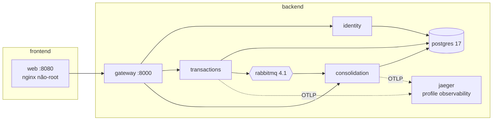
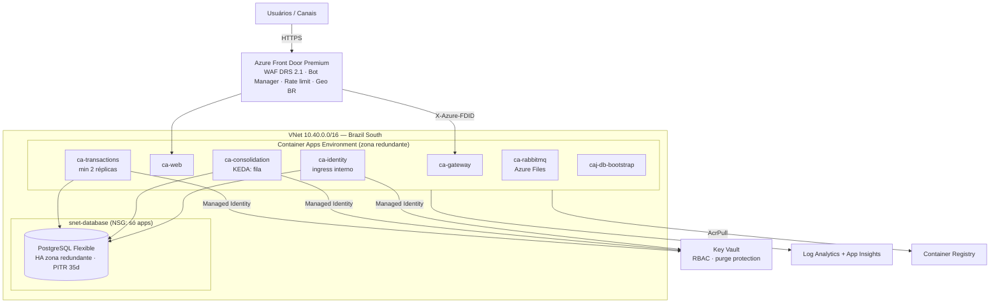

# 5. Arquitetura de Tecnologia (TOGAF ADM — Fase D)

## 5.1 Stack

| Camada | Tecnologia | Versão | Licença | Decisão |
|---|---|---|---|---|
| Runtime | .NET / ASP.NET Core | 10.0 LTS | MIT | [ADR-0010](../adr/0010-runtime-dotnet-10-lts.md) |
| Persistência | PostgreSQL + EF Core + Npgsql | 17 / 10.0 | PostgreSQL / MIT | [ADR-0011](../adr/0011-postgresql.md) |
| Mensageria | RabbitMQ + RabbitMQ.Client | 4.1 / 7.2 | MPL-2.0 / Apache-2.0 | [ADR-0003](../adr/0003-mensageria-rabbitmq.md) |
| Gateway | YARP | 2.3 | MIT | [ADR-0014](../adr/0014-api-gateway-e-protecao-de-borda.md) |
| Validação | FluentValidation | 12.2 | Apache-2.0 | |
| Resiliência | Polly | 8.9 | BSD-3 | |
| Observabilidade | OpenTelemetry .NET (OTLP) | 1.20 | Apache-2.0 | |
| Documentação de API | Microsoft.AspNetCore.OpenApi + Scalar | 10.0 / 2.18 | MIT | |
| Testes | xUnit v3, Shouldly, NSubstitute, Testcontainers | — | Apache-2.0 / BSD-3 / MIT | [ADR-0007](../adr/0007-bibliotecas-e-licencas.md) |
| Containers | Docker (multi-stage, Alpine, não-root) | — | — | |
| Nuvem | Azure Container Apps, PostgreSQL Flexible Server, Key Vault, Front Door Premium + WAF | — | — | [ADR-0009](../adr/0009-azure-container-apps.md) |
| IaC | Terraform + azurerm | 1.13 / 4.81 | BUSL (CLI) / MPL-2.0 | |
| CI | GitHub Actions + Dependabot | — | — | |

## 5.2 Ambiente local (Docker Compose)

- Builds **multi-stage** (SDK só no estágio de build), restore em **modo travado** (lock files), imagem final `aspnet:10.0-alpine` executando como **usuário não-root** (`$APP_UID`) com binários somente-leitura.
- **Healthchecks** em todos os containers; `depends_on: condition: service_healthy` garante ordem de subida.
- Hardening em runtime: `read_only: true`, `tmpfs /tmp`, `cap_drop: ALL`, `no-new-privileges`, limites de CPU/memória.
- **Segredos via Docker secrets** (arquivos em `/run/secrets`, lidos pelo provedor `KeyPerFile`), gerados por `scripts/generate-secrets.*`. Nada sensível no `docker-compose.yml` nem no repositório.
- Redes separadas: `frontend` (web ↔ gateway) e `backend` (serviços, banco, broker). Postgres e RabbitMQ Management expostos só em `127.0.0.1`.

## 5.3 Ambiente de nuvem (Azure, Terraform)

Código: [`infra/terraform`](../../infra/terraform) — módulos `network`, `observability`, `keyvault`, `postgres`, `container_apps`, `edge` compostos em `modules/platform`; ambientes `environments/dev` e `environments/prod`. Estado remoto em Storage com autenticação Entra ID e lock.

| Aspecto | dev | prod |
|---|---|---|
| Réplicas mínimas por API | 0 (escala a zero) | 2 (zonas distintas) |
| PostgreSQL | B1ms, sem HA | GP D2ds_v5, HA zona redundante, geo-backup, PITR 35 d |
| WAF | Detection | Prevention + geo-filtro BR |
| Logs | 30 d, teto 2 GB/dia | 90 d, teto 10 GB/dia |
| Orçamento | US$ 700/mês | US$ 2.600/mês |

## 5.4 Escalabilidade e capacidade
- **Stateless:** todas as APIs escalam horizontalmente; nenhum estado em memória além de caches de configuração.
- **Lançamentos:** gargalo natural é a contenção por conta (concorrência otimista). Contas diferentes escalam linearmente. Para contas "quentes" (ex.: conta de liquidação), evolução: *sharding* do saldo ou fila serial por conta.
- **Outbox:** várias réplicas processam em paralelo (`SKIP LOCKED`); lote de 100 a cada 500 ms ≈ 200 eventos/s por réplica, e lotes cheios são processados sem espera.
- **Consolidado:** KEDA escala por profundidade de fila; leituras são consultas indexadas O(dias + lançamentos do dia). Medido localmente (4 vCPU): **90 req/s com p95 7,7 ms** e 0% de erro.
- **Banco:** pool de conexões por réplica limitado (60); PgBouncer integrado do Flexible Server habilitável; réplica de leitura para o Consolidado se necessário.

## 5.5 Alta disponibilidade e recuperação de desastres

| Componente | HA | DR |
|---|---|---|
| APIs | ≥ 2 réplicas em zonas distintas; probes | Imagens no ACR; IaC recria a região |
| PostgreSQL | Standby síncrono em outra zona (failover automático) | Geo-backup → restauração em região par |
| RabbitMQ | Fase 1: nó único persistente (outbox protege escrita) → alvo cluster 3 nós | Mensagens não confirmadas permanecem no outbox |
| Front Door | Global, gerenciado | — |

**RPO:** 0 para lançamentos confirmados (commit síncrono + HA). **RTO:** ~minutos para falha de zona; < 4 h para falha de região (restauração geo + IaC).
