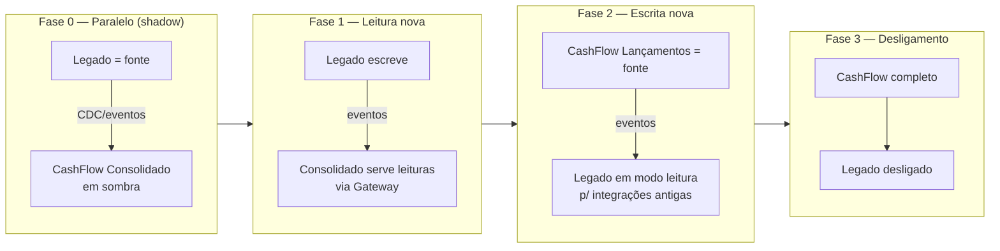

# 8. Oportunidades, Soluções e Plano de Migração (TOGAF ADM — Fases E/F)

## 8.1 Estratégia de transição do legado — Strangler Fig

| Fase | Critério de saída | Rollback |
|---|---|---|
| 0 — Sombra | Divergência zero entre saldo legado e consolidado por 30 dias (reconciliação diária automatizada) | Desligar consumidor |
| 1 — Leituras | SLO de leitura atendido por 2 semanas com 100% do tráfego | Gateway volta a rota para o legado |
| 2 — Escritas | Canais migrados por lote (feature flag por canal); reconciliação contínua | Flag por canal |
| 3 — Desligamento | Nenhum consumidor do legado; dados históricos migrados e reconciliados | — |

Migração de dados históricos: carga inicial dos saldos de abertura por conta como lançamentos de "saldo inicial" datados, seguida de reconciliação.

## 8.2 Roadmap de evolução

| Horizonte | Item | Motivação |
|---|---|---|
| Curto | IdP corporativo (Entra ID) com MFA; OpenIddict para client credentials | ADR-0008 |
| Curto | RabbitMQ em cluster de 3 nós (quorum real) | ADR-0003 |
| Curto | Private Link Front Door → ACA interno; Private Endpoints KV/ACR | Segurança |
| Médio | Estornos com fluxo de aprovação (4 olhos) e transferências (saga com compensação) | Negócio |
| Médio | Cache distribuído (Redis) para consolidado em leituras repetidas | Pico > 500 rps |
| Médio | Particionamento de `transactions` por mês; arquivamento frio | Volume |
| Médio | Publicar o CashFlow no Apigee do banco (API products, quotas, portal de desenvolvedor) | Exposição de APIs (ADR-0014) |
| Longo | CDC (Debezium) no lugar do polling do outbox | Latência/escala |
| Longo | Multi-região ativo-passivo com failover do banco | DR < 1 h |

## 8.3 O que eu faria diferente com mais tempo
- Fechamento contábil no fuso America/Sao_Paulo com regra de "data de competência" separada da data de processamento.
- Testes de caos automatizados no CI (Toxiproxy) para latência de rede e partições.
- Mutation testing (Stryker.NET, Apache-2.0) nas regras de domínio.
- Contract testing com schema JSON gerado a partir do AsyncAPI e publicado como artefato versionado.
