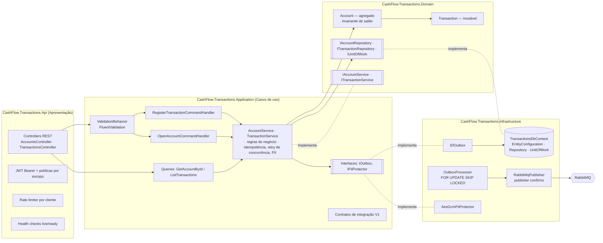
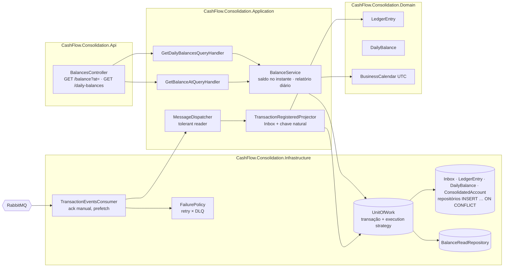

# C4 — Nível 3: Componentes (Lançamentos e Consolidado)

Os dois serviços de negócio seguem a Clean Architecture com CQRS, Repository e Unit of Work (camadas 1 - Presentation, 2 - Application, 3 - Domain, 4 - Infra). As dependências apontam para dentro: o Domain define entidades e as interfaces de repositório e de Unit of Work, a Application orquestra os casos de uso e a Infrastructure implementa as interfaces ([ADR-0013](../adr/0013-clean-architecture.md)).

## Serviço de Lançamentos

## Serviço de Consolidado

