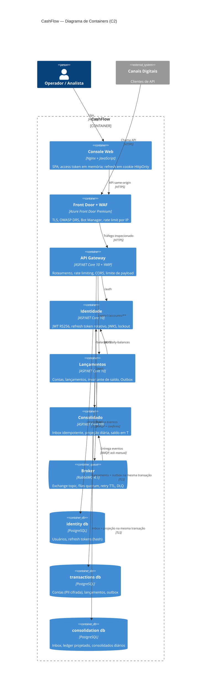

# C4 — Nível 2: Containers

Inclui a camada de UI/Cliente (Console Web), a borda (Front Door + WAF), o Gateway, os três serviços e seus armazenamentos. Fonte formal: [`workspace.dsl`](workspace.dsl).

## Responsabilidades e decisões por container

| Container | Tecnologia | Escala | Dados que possui | Decisões |
|---|---|---|---|---|
| Console Web | Nginx (imagem não-root) + JS sem framework | Horizontal, estático | Nenhum | CSP restritiva; token em memória; Idempotency-Key gerada no cliente |
| Front Door + WAF | Azure Front Door Premium | Gerenciado | — | [ADR-0014](../adr/0014-api-gateway-e-protecao-de-borda.md) |
| API Gateway | YARP | Horizontal, stateless | — | [ADR-0014](../adr/0014-api-gateway-e-protecao-de-borda.md) |
| Identidade | ASP.NET Core | Horizontal | Usuários, refresh tokens | [ADR-0005](../adr/0005-autenticacao-jwt-rs256-e-refresh-token.md), [ADR-0008](../adr/0008-servico-de-identidade-proprio.md) |
| Lançamentos | ASP.NET Core, Clean Architecture | Horizontal (concorrência otimista + SKIP LOCKED no outbox) | Contas, lançamentos, outbox | [ADR-0002](../adr/0002-microsservicos-lancamentos-e-consolidado.md), [ADR-0012](../adr/0012-transactional-outbox-e-inbox.md) |
| Broker | RabbitMQ (quorum queues) | Cluster de 3 nós (alvo prod) | Mensagens em trânsito | [ADR-0003](../adr/0003-mensageria-rabbitmq.md) |
| Consolidado | ASP.NET Core, Clean Architecture | Horizontal + KEDA por profundidade de fila | Inbox, ledger projetado, diários | [ADR-0006](../adr/0006-consistencia-eventual-e-projecao-comutativa.md), [ADR-0012](../adr/0012-transactional-outbox-e-inbox.md) |
| PostgreSQL | Flexible Server (HA zona redundante) | Vertical + réplicas de leitura | Database-per-service | [ADR-0011](../adr/0011-postgresql.md) |
