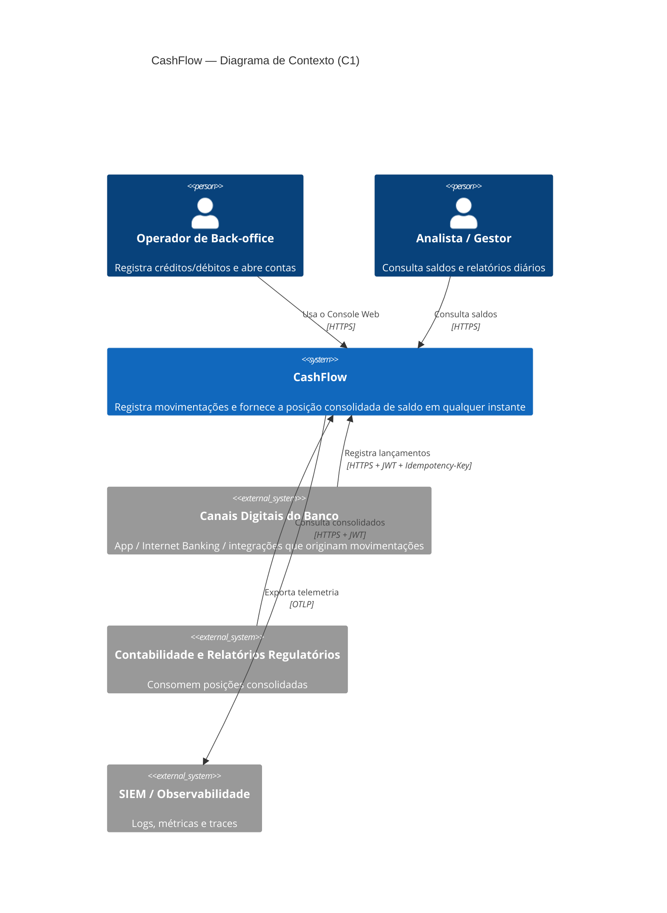

# C4 — Nível 1: Contexto do Sistema

Visão de quem usa o CashFlow e com quais sistemas ele se relaciona. Fonte formal: [`workspace.dsl`](workspace.dsl).

| Elemento | Responsabilidade | Interação |
|---|---|---|
| Operador | Opera contas e lançamentos manuais | Console Web (UI) |
| Analista / Gestor | Acompanha saldos e consolidado diário | Console Web (UI) |
| Canais Digitais | Originam a maior parte das movimentações | API REST via Front Door/Gateway |
| Contabilidade / Regulatório | Consomem posições consolidadas | API REST (somente leitura) |
| SIEM / Observabilidade | Monitoramento, auditoria e alertas | OTLP / Log Analytics |
